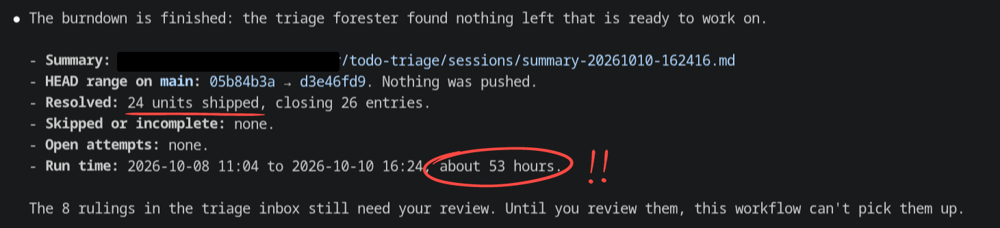

# ccc-agentgen

Ready-made agent workflows for [`ccc`](https://github.com/rnortman/ccc), the
CLI that runs an agent as a one-shot Claude Code or Codex subprocess: a
**review chain** that designs, implements and reviews a change on Claude Code
and/or Codex, and a **TODO triage and burndown** pair that rules on a
repository's `TODO.md` and works it down. Plus the generator that renders
them into ccc agent definitions.

There are many variations of several different workflows. Using `ccc`, workflows
can combine Claude and Codex agents. And they can run for a *verrrrry* long time
and get a lot done, autonomously if you like:



Long workflows like that are made possible by both the workflow design and by
`ccc`, which can juggle multiple Claude subscription accounts, switching between
them as they run out of usage.

The key workflow design insight for long workflows is this: *the orchestrator
should have no idea what you're building.* In these workflows, the orchestrator
just manages the workflow. It doesn't design, or decompose tasks, or make
decisions. It keeps the workflow moving. Sugagents communicate by writing
documents and reading documents. The orchestrator never reads any of it. That
keeps its context window clean and focused on orchestration.

The todo burndown workflow takes this to another level: It has an orchestrator
orchestrating orchestrators. The top-level orchestrator just launches
sub-orchestrators for different units; that way a single top-level orchestrator
can run for **53 hours** without ever filling up its context window and without
ever compacting. If you need even longer workflows, you can hand off between
sessions.

`templates/` and `variants/` are the product; `src/agentgen/` is the tool that
assembles them. You can use the workflows as they are (they are customizable),
or just take `agentgen` as a tool and build your own workflows.

I frequently update my workflows. There is no stability here; fork it or pin a
specific version if you want stability.

## Requirements

- **`ccc`** on `PATH`: `cargo install --locked ccc-harness`, or `cargo install
  --locked --git https://github.com/rnortman/ccc`. See ccc's
  [Install](https://github.com/rnortman/ccc#install) section for what that
  needs.
- **`claude` and/or `codex`** CLIs on `PATH`, logged in (`CCC_CLAUDE_BIN` /
  `CCC_CODEX_BIN` override the lookup; ccc's
  [Install](https://github.com/rnortman/ccc#install)). Every role in every
  variant runs on either harness, except `coder` (Codex only) and
  `coder-supervisor` (Claude only) in the `review-chain-split*` variants, and
  `pr-liaison` (Claude only) in the `review-chain-stack-followup*` variants.
  So:
  - **With Claude alone** you can run every variant except
    `review-chain-split`, `review-chain-split-auto`.
  - **With Codex alone** you can run every variant except
    `review-chain-split`, `review-chain-split-auto`,
    `review-chain-stack-followup`, `review-chain-stack-followup-auto`.
- **[`uv`](https://docs.astral.sh/uv/)**: every command below is `uv run …`.
  uv fetches its own Python 3.12 (`.python-version`, `python-preference =
  "only-managed"`), so no system Python is needed. Where uv's configuration
  sets `python-downloads = "manual"` — distribution-packaged uv may, as
  Fedora's does in `/etc/uv/uv.toml` — install that Python once:

  ```
  uv python install 3.12
  ```
- **Bash with GNU findutils** for the `ccc-use` switcher (`shell/ccc-env.sh`
  uses `mapfile`, `[[ -v ]]`, `complete` and `find -printf`): Linux, or macOS
  with Homebrew `bash` and `findutils`. In another shell, set
  `CCC_AGENTS_CONFIG` by hand to a file under `<ccc-dir>/configs/`.
- **For `todo-triage` in a repository that keeps `todo.d/` fragments
  only:** [allthechanges](https://github.com/rnortman/allthechanges) on
  `PATH` (`cargo install allthechanges`). A repository without a `todo.d/`
  or `.todo.d/` never runs it; in one with, every `todo-triage` command
  fails with that install command until it is there.
- **For `review-chain-stack-followup*` only:** the forgejo MCP server,
  [`brenn-forgejo-mcp`](https://github.com/rnortman/brenn-forgejo-mcp),
  configured in Claude Code under the server name `forgejo` (the liaison
  calls its tools as `mcp__forgejo__forgejo_*`).

## Quick start

From nothing to a review-chain cycle on your own project. The TODO workflows
have their own quick start in [TODO triage and burndown](#todo-triage-and-burndown).

1. **Clone.**

   ```
   git clone https://github.com/rnortman/ccc-agentgen && cd ccc-agentgen
   ```

2. **Know `<ccc-dir>`.** It is ccc's configuration directory:
   `$XDG_CONFIG_HOME/ccc` when `XDG_CONFIG_HOME` is set, else
   `~/.config/ccc`. The rest of this README writes `<ccc-dir>` for it.

3. **Write a preference file**, `<ccc-dir>/prefs/default.toml`. A complete
   minimal one:

   ```toml
   default_harness = "claude"   # or "codex"; the harness a role gets when nothing pins it

   [agents.explorer]            # optional per-role overrides, ccc's [agents.<type>] shape
   effort = "low"
   ```

   An empty file is valid too. A preference file holds `default_harness` and
   `[agents.<type>]` tables (`harness`, `model`, `effort`, `codex_model`,
   `codex_effort`, and `"*"` as a wildcard type; ccc's
   [Configuration](https://github.com/rnortman/ccc#configuration) section)
   and nothing else. `deploy` refuses `agents_dir` (it writes that line
   itself), any site key (`[claude]`, `[codex]`, `[mqtt]`, `[process]`,
   `[launch]`, which belong in ccc's `<ccc-dir>/config.toml`, as the error
   says), and any unknown top-level key. Several files make several
   selectable preference sets; the file stem is the `[prefs]` argument to `ccc-use` below — with
   one file it can be omitted, with more than one it must be named. If you
   already have a `<ccc-dir>/agents.toml`, copy it to
   `<ccc-dir>/prefs/default.toml` and delete its `agents_dir` line.

4. **Deploy.** From the clone root:

   ```
   uv run agentgen deploy
   ```

   (or `agentgen deploy --root <clone>` from anywhere, after `uv tool install
   .`). Every variant's definitions go to `<ccc-dir>/agents/<variant>/`, and
   one agents config per variant and preference file to
   `<ccc-dir>/configs/<variant>/<prefs>.toml`. It prints the `source …` line
   for the next step. Re-running `deploy` after a `git pull`
   is the upgrade path; variant directories under `<ccc-dir>/agents/` that no
   variant produces any more are reported and left for you to remove.

5. **Select a variant.** Add the printed `source <clone>/shell/ccc-env.sh` to
   `.bashrc`, open a new shell, and run:

   ```
   ccc-use review-chain
   ```

   `ccc-use` alone lists the variant/preference pairs and the current
   selection; `ccc-use off` returns to `<ccc-dir>/agents.toml`.

6. **Tell your project where cycle artifacts go.** A cycle writes its
   request, design, reviews and implementation log into one directory, the
   **working dir**. The orchestrator picks it "per the project's
   documentation standard if any", so give the project one: a paragraph in
   its `CLAUDE.md` or `AGENTS.md` naming an **ADR directory** convention —
   where each cycle's directory lives. Two layouts:

   - **Same-repo**: inside the project, committed with it. Not available to
     the stack chains (`review-chain-stack*`) or to a cycle with more than
     one repository in scope.

     > Workflow artifacts go under `docs/adr/YYYY/MM/DD-<slug>/` in this
     > repository, one directory per cycle.

   - **Sidecar**: a separate repository beside the project, which the
     orchestrator commits to itself.

     > All design docs and workflow artifacts go in the ADR sidecar repo
     > `../<project>-adr`. Each cycle creates a new directory there,
     > `YYYY/MM/DD-<slug>/`.

7. **Raise the Bash ceiling** in the shell you launch drivers from:

   ```
   export BASH_MAX_TIMEOUT_MS=86400000
   ```

   Under Claude Code the Bash tool's background ceiling is two hours unless
   `BASH_MAX_TIMEOUT_MS` raises it, and a ceiling hit kills the whole
   subtree. Export it in the environment the top-level driver is started
   from; every `ccc` and every harness child beneath it inherits it. Do not
   set it through a `--settings` in the ccc config's `[claude] extra_args`:
   that replaces the `Stop` hook ccc injects on interactive Claude launches.
   A launch that returns without a reply — `ccc` exiting non-zero, or the
   spawner's shell tool stopping it at its limit — is a **cut-off launch**,
   and the spawner resumes it itself (`ccc resume <id> "Continue."`) before
   anything reaches you: a failed one at most twice, a ceiling hit at most
   four times.

8. **Launch.** Know first what ccc's
   [Quick start](https://github.com/rnortman/ccc#quick-start) step 3 says:
   Claude subagents run with `--permission-mode bypassPermissions` unless
   ccc's site config says otherwise, so the cycle's agents edit, run commands
   and commit without prompting; and every Claude spawn marks its working
   directory trusted in the account's `.claude.json`, so `--cwd` is a
   statement that you trust that checkout's hooks and MCP servers. See
   [Operator configuration](#operator-configuration).

   ```
   ccc launch orchestrator --cwd <your project>
   ```

   and type the request in the session that opens; or write `request.md` in
   a fresh directory under your ADR directory first and name its path. The
   cycle then stops for you at the design gate (approve, or send notes), at
   the end of each implementation round, and at the ship gate, each a
   question you answer in chat. In an `-auto` variant the forester answers
   those stops instead and you come back to its report; see
   [Choosing a variant](#choosing-a-variant).

## Choosing a variant

Fourteen variants ship: eleven review chains and three TODO workflows.

| Variant | What it is | CLIs |
| --- | --- | --- |
| `review-chain` | The full chain, one `implementer` role | Claude or Codex |
| `review-chain-auto` | `review-chain` with the forester deciding the stops | Claude or Codex |
| `review-chain-lite` | A shorter chain on cheaper models | Claude or Codex |
| `review-chain-split` | Implementer split into planner, Claude supervisor, Codex coder | Claude and Codex |
| `review-chain-split-auto` | `review-chain-split` with the forester deciding | Claude and Codex |
| `review-chain-planner` | Planner plus a self-checking implementer | Claude or Codex |
| `review-chain-planner-auto` | `review-chain-planner` with the forester deciding | Claude or Codex |
| `review-chain-stack` | Ships a stack of PR-sized commits | Claude or Codex |
| `review-chain-stack-auto` | `review-chain-stack` with the forester deciding | Claude or Codex |
| `review-chain-stack-followup` | Answers review on an open stack and republishes it | Claude |
| `review-chain-stack-followup-auto` | `review-chain-stack-followup` with the forester deciding | Claude |
| `todo-triage` | Rules on every unruled `TODO.md` entry | Claude or Codex |
| `todo-burndown` | Works ruled entries down through `review-chain` | Claude or Codex |
| `todo-burndown-auto` | Works ruled entries down through `review-chain-auto` | Claude or Codex |

"Claude or Codex" means either CLI alone runs it; "Claude and Codex" means
it needs both.

`review-chain` is the full chain with one `implementer` role.
`review-chain-lite` drops the ELI5 rendering, the review pre-pass, the
comment rewriter, the round-close scan, the explorer and the forester
family, and runs cheaper models. `review-chain-split` replaces the
implementer with `planner` (chooses the slice, writes a stand-alone plan),
`coder-supervisor` (Claude-only; runs the coder to a commit) and `coder`
(Codex-only; implements the plan). `review-chain-planner` keeps the planner
but drops the supervisor: the `implementer` lands each plan itself, sees the
design, checks its own work, and returns `replan` or `respawn` exactly as the
supervisor does. It keeps the `implementer` agent type so operator settings
for `coder` apply only to the split chain. The orchestrator renders the
planned loop on `"planner" in roles`, naming `coder-supervisor` or
`implementer` as the worker on `"coder" in roles`; without a planner it
renders the self-scoping implementer loop. `review-chain-auto`,
`review-chain-split-auto` and `review-chain-planner-auto` are those chains
with the forester deciding instead of advising. In them the plain-language
rendering is not produced at the design gate — the forester holds it — but
the user can ask for one at any stop, and gets `design-eli5-<K>.md` covering
the design and every delta.

`review-chain-stack` and `review-chain-stack-auto` ship a stack of PR-sized
commits instead of one squashed commit. They are `review-chain` and
`review-chain-auto` with a `pr-assembler` in place of the `changelog-author`,
and with smaller increments (at most four per PR, 400–800 lines each, stopping
at 1200). The design carries a **Stack** section — the ordered PRs, each with
a branch name, a title, the design items it delivers and an estimated size
(`[vars]` `pr_target_lines`, at most `pr_max_lines`) — reviewed and frozen
with the design and changed only by deltas, which never move, remove or
rename a PR already assembled. A round is one PR: it closes when the
implementer replies `pr-done`, and `pr_max_lines` and `max_increments` are
stops that go to triage, never closers. A fix to an earlier PR is a
`git commit --fixup` targeting that PR's branch, reviewed with the round.
After each round's review the `pr-assembler` restacks every fixup into its
PR with `rebase --autosquash`, squashes the round into the PR's one commit
with a message that is the PR's title and description, writes the PR's
changelog line and creates its branch; the orchestrator checks mechanically
that the top of the stack is the tree that was reviewed. At the ship gate
nothing is squashed and nothing is pushed, in either variant: the user
pushes the branches. The stack chains require the workflow's artifacts —
log, design, PR records — to live in a repository other than the code's,
because the assembler rewrites the code repository's history; the
orchestrator refuses to start when the working dir is inside the code
repository. The stack orchestrator creates a dedicated work branch,
`<request slug>-stack-work`, at setup and never moves the branch it was
launched on; the stack branches are the product.

`review-chain-stack-followup` and `review-chain-stack-followup-auto` run a
second cycle over a stack whose PRs are open and reviewed on the code host.
They are the stack variants plus a `pr-liaison` role, the only role that
talks to the code host: it reads every PR's review threads into
`pr-comments-<K>.md`, posts the answers the design writes, and publishes
the rewritten stack. Name the working dir of the cycle that last shipped
the stack (the directory holding its `design.md`), a stack cycle or an
earlier follow-up, when you launch; the liaison finds the stack from its
records and refuses a stack whose local branches, remote branches
and PR heads disagree, or whose PRs are not all open. The stack's PRs are
looked for on the remote the request names (or your launch words name),
else the remote the previous follow-up published to, else `origin`; every
push of the cycle goes to that one remote.

Launching a follow-up that also names a **base** — a local branch, "onto
`<branch>`" — re-creates the stack on it: each inherited PR is rebuilt in
its own round (its shipped commit replayed, this cycle's changes added),
reviewed whole and squashed onto its existing branch; an entry the design
drops is closed on the host. Publish re-points each PR's base on the host
and never touches a PR's title or body. The base is taken at the branch's tip:
to remove a PR in place, name a branch created at the stack's current base,
the bottom branch's parent, since a branch such as `main` has usually moved
past it. That costs one round per surviving PR, and a surviving PR grown
past the size limit is re-split into new PRs. A follow-up that names no base
never moves or removes a PR. If you push by hand, run publish without a push
afterwards: it writes the record the next follow-up reads and closes the
removed PRs.

The design answers every thread in a **Responses** section and lands its
code changes as fixups into the PRs they belong to, or as new PRs on top.
The liaison is pinned to Claude (`harness: claude`): it calls the forgejo MCP
server's tools by their Claude Code names (`mcp__forgejo__forgejo_list_prs`,
`_get_pr`, `_get_review_comments`, `_get_pr_comments`, `_post_review`,
`_open_pr`, `_update_pr`, `_close_pr`), which a role reaches only when its
`tools:` list names them, and the Codex configuration carries no forgejo
server. In the plain variant the responses are posted at every design gate
the review chain cleared; your word to proceed freezes the design as it
stands, and comments posted after the last fetch wait for the next cycle. A
gate reached through a review escalation posts nothing, and your word to
proceed there posts the responses and then freezes. The plain variant never
pushes on its own: after the cycle, `force-push the stack` force-pushes every
stack branch with a lease, in one atomic push, re-targets and closes PRs as
the stack says, and opens the new PRs, and "open the PRs" opens them without
pushing, giving the lease command to run by hand for the branches not yet
pushed. In `-auto` the responses are posted once the forester approves the
design, and the forester's ship approval force-pushes the stack with a lease,
re-targets and closes PRs as the stack says, and opens the new PRs.

The TODO workflows are described in
[TODO triage and burndown](#todo-triage-and-burndown).

## Deploy and `ccc-use` in detail

[Quick start](#quick-start) steps 3–5 give what a preference file may hold,
where `agentgen deploy` writes, and how `ccc-use` selects a pair; this
section covers the rest. Site settings live in ccc's `<ccc-dir>/config.toml`
and are always read, whatever pair is selected.

Every deploy regenerates `<ccc-dir>/configs/` from `prefs/ × variants`, so
deleted inputs do not leave stale generated configs and no preferences leaves
`configs/` empty (it keeps its `.agentgen-deploy` marker). Each generated file
is an agents config: a one-line provenance comment, `agents_dir`, then the
preference file's text. `prefs/`, `config.toml` and `agents.toml` are
untouched. With `prefs/` empty, deploy warns, composes no configs and prints
the command that starts one from an existing `agents.toml`. A shell exporting
a removed `CCC_AGENTS_CONFIG` names a nonexistent file, and ccc refuses to run
with an error naming `CCC_AGENTS_CONFIG`; run `ccc-use off`, or restore
preferences and redeploy before choosing a pair again. `ccc-use` with no
arguments reports the current selection and currently existing pairs.

Source the exact `shell/ccc-env.sh` path printed by deploy from `.bashrc`. It
provides `ccc-use`, `ccc-use <variant> [prefs]`, and `ccc-use off`.
`ccc-use <variant> [prefs]` exports `CCC_AGENTS_CONFIG`; `ccc-use off` unsets
it, and ccc then reads the default `<ccc-dir>/agents.toml`. `ccc-use` never
sets `CCC_CONFIG`; when `CCC_CONFIG` names a file under `<ccc-dir>/configs/`,
which holds only agents configs, every `ccc-use` call warns and says to
`unset CCC_CONFIG`. `[agents.<type>]` settings for a role absent from the
selected variant are harmless, while requesting a harness the definition
disallows remains a runtime ccc error.

## Repositories in scope

A review-chain cycle may change more than one repository, but only the ones
you name. The **scope** starts as the repository the orchestrator is
launched in (the **primary**). Widen it with a **scope phrase** — `in
scope:`, `also in scope:` or `scope:` followed by one or more paths — in your
launch words or your answer at any stop; narrow it with `drop from scope:
<path>`. A path mentioned any other way, including in the request, never
widens the scope. Only you widen it: no agent, triage ruling or forester
does, because bringing a repository in means coordinating with whatever
else is running there. At every stop the orchestrator states the scope back
in one `scope:` line.

No agent writes, commits, runs a mutating command or files a TODO in a
repository outside the scope. A change an agent finds it needs in another
repository you own — a defect in a dependency, a missing feature in a
sibling — is never worked around: it reaches you with the repository, the
change, why nothing in scope will do, and a paste-ready `TODO.md` entry,
and you choose to bring the repository in, file the entry, or stop.

Every non-stack design has a **Scope** section: one entry per repository it
changes, primary first, with what changes there and, where one repository
pins another, the strategy:

- **override** — the dependent is developed and tested against the local
  checkout of the dependency within the cycle; the design states the
  override edit and the restoration of the pin.
- **sequential** — this cycle changes the dependency only; the dependent's
  change is a declared **follow-up** cycle whose request is the **Scope**
  entry, and the closing stop names it (`next: a follow-up cycle in …`).

The ship gate ships one squash per repository, in the **Scope** section's
ship order, each with its own gate and changelog. After a repository that
another one pins is squashed (and, in `-auto`, pushed off `main`), the
cycle stops in every autonomy: `Waiting: the shipped reference of <X> for
the pin in <Y>`. Ship it, answer with the reference, and the implementer
restores the pin to it, runs the dependent's full check and commits; then
the dependent ships. An in-scope repository the cycle never changed is
retired as `unchanged`. The closing stop lists every repository. Once a
repository has shipped, the orchestrator stops watching its HEAD: shipping
it is yours, and it cannot be dropped from the scope. At a ship-gate stop,
`drop from scope:` abandons a repository not yet shipped (`restore` resets
its commits away first); a dependent whose dependency you drop goes to
triage.

The stack chains (`review-chain-stack*`) stay in one repository: they
refuse a scope phrase, and a change needed elsewhere is a `TODO.md` entry
you file or a stop.

More than one repository in scope requires the ADR directory in a separate
repository (the sidecar layout, [Quick start](#quick-start) step 6); in the
same-repo layout a scope phrase is refused.

### Operator configuration

Claude subagents run with `bypassPermissions` and can write any in-scope
repository. Codex subagents run in `workspace-write` and can write only
their cwd unless the Codex config's `[sandbox_workspace_write]
writable_roots`, or `[codex] extra_args = ["--add-dir", "<dir>"]` in
`ccc`'s site config, covers every repository you may bring into scope — the
directory holding the sibling checkouts is the natural root. Without it a
Codex implementer is refused by the sandbox and escalates, quoting the
denial; it never moves the work into the primary.

## Forester family

Two product-owner-proxy roles, both pinned to the most capable models and
both working from documents, never code:

- `forester` — sits at the gates the user would hold. `[vars]`
  `forester_gates` picks which of `design`, `triage`, `scan`, `ship`;
  `forester_autonomy` is `advise` (writes a brief, the user still decides) or
  `decide` (its ruling is the gate's outcome, the user returns for its report
  at cycle end or on escalation). Directions it gives go to
  `userproxy-notes-*` files, each opening with a disclaimer that an agent, not
  the user, wrote it. `forester_gate_rounds` caps the forester↔designer loop.
  In `decide` mode a design-gate approval accepts every open question at the
  default the design states; any other answer goes down as userproxy notes
  and the design returns revised; a question without a default cannot be
  approved past. In `decide`
  mode with the `ship` gate, a forester-approved squash pushes the current
  branch to `origin` without asking; on `main` it does not, and the cycle
  ends `shipped` with the HEAD unpushed; a push on `main` is a later
  instruction, never a gate. A forester-approved ship owes the user nothing
  that is not in the tree or the closing stop — anything else the user must
  know or do goes down as notes or up as an escalation, never into a
  caveat — and its report is a page of facts with no recommendation. The
  forester's scan gate is held after intermediate rounds only; on the final
  round the ship gate reads the scan report.
- `forester-commentator` — after every review wave with findings, before the
  responder, writes `commentary-<step>.md`: questions (reachability, cost to
  maintain, fit to the request), not dispositions. Tools are `Read` and
  `Write` only so it cannot reach the code.

Shared partials: `forestry` (the owner's perspective), `desk` (what is read),
`forester-log`, `forester-escalation`, `userproxy`.

Every role ends its reply with one line the orchestrator routes on:

```
[agent] status=<OK|RETRY|ESCALATE> result=<token|-> out=<abs-path|-> commit=<hash|->
```

`RETRY` is a relaunch the orchestrator performs by table lookup; `ESCALATE`
hands a document up the supervision chain. `tests/test_golden.py` holds the
closed `result` vocabulary per role.

## TODO triage and burndown

Two workflows over a repo's `TODO.md`, and the `todo-triage` tool they run on.

**Quick start.**

1. Install the tools from the root of your clone of this repository:

   ```
   uv tool install .
   ```

   That puts `todo-triage` and `agentgen` in `~/.local/bin`, where agents can
   reach them (ccc adds nothing to `PATH`). `agentgen deploy` does not
   install them.
2. The repository needs a tracker the tool parses. `TODO.md` is a `# `
   title line, then one entry per `` ## `<slug>` `` heading (a bare slug is
   accepted with a warning), each entry running to the next `## `; there
   are no sections. Headings are found outside fenced blocks only, and
   every line starting with three backticks or three tildes opens or closes
   a fence, whichever character opened it — the rule
   [allthechanges](https://github.com/rnortman/allthechanges) reads by, kept
   so both tools split a file the same way. A fence left open at the end of
   the file is a lint error, since it hides entries the tool would
   otherwise count as gone; so are a `## Open` section, a heading deeper
   than `## ` and a `# ` heading after the first entry. A file with a
   `## Open` section reads as no entries, so every command but `lint`
   refuses it.
   Optionally, entries also live one per file in `todo.d/` (or `.todo.d/`)
   as `<slug>.md` holding the entry text alone; the tool reads them by
   running `allthechanges --json todo query`, and `TODO.md` may then be
   absent. An entry's text is hashed without its heading or layout, so
   `allthechanges todo gather` moving fragments into `TODO.md` keeps their
   rulings (an entry's first-seen date becomes the gather commit's). A
   `todo-triage` slug is lowercase, which allthechanges does not require; a
   fragment with any problem has no row until it is fixed, and `lint` names
   it. Code points at an entry with a `TODO(<slug>)` comment. `todo-triage
   lint --repo <repo>` checks the tracker. `--repo` must be a git work
   tree.
3. Pick a **store** directory outside the code repo, e.g.
   `../<repo>-notes/todo-triage/`, and a **tag**. You need not create the
   store: when its `store.yaml` is missing, the triage orchestrator asks for
   the tag and runs `init` itself. By hand it is
   `todo-triage init --repo <repo> --store <store> --tag <tag>`. The tag names the burndown ADR directories,
   `<adr-root>/YYYY/MM/DD-<tag>--todo-<slug>`, where the **ADR root** is the
   root of your ADR directory ([Quick start](#quick-start) step 6) — for a
   sidecar, the sidecar repository's root.
4. `ccc-use todo-triage`, then `ccc launch triage-orchestrator --cwd <repo>`
   and name the store.

Rulings and every document behind them live in the store, so nothing in the
repo points at it and no agent adding a TODO can see or imitate the
annotations. Every command takes `--repo` (default: cwd) and `--store` (all
but `lint`), before or after the command name, and the global `--json`
option for machine-readable output.

- **`todo-triage`** — launched as in step 4 above. For each entry nobody
  has ruled on, in file order: a `sketcher` ground-truths it against the code
  and argues for and against, a `contrarian` second-guesses the sketch, and
  the `triage-forester` rules as the product owner would — `do` with a
  priority 1–4, `defer`, `blocked`, or `delete`. The tool validates and records
  each ruling with its date; an entry whose text changes, or whose ruling ages
  past `stale_days`, comes back for re-triage. A `blocked` ruling may carry a
  priority too: the entry is then ready for burndown at that priority,
  without re-triage, once every blocker has left `TODO.md`; `todo-triage
  ready` shows, beneath each ready entry, the entries it unlocks, two levels
  deep. The session ends
  with a summary and `todo-triage prune`'s list of entries ruled `delete`
  (and approved) with their `TODO(slug)` comments. On your word, the
  `site-remover` removes every such comment, rewriting what a comment also
  said about the code where that earns its place, and stages its edits with
  a report at the path `todo-triage path --prune` prints; then `todo-triage
  prune --write` removes the entries from `TODO.md` and deletes their
  `todo.d/` files, refusing while any of their comments remains, and prints
  the paths it changed. The orchestrator stages the files the tool changed
  and shows you
  the staged diff; one commit of both is made only on your word, with your
  message or a default. Comments left behind by entries pruned in earlier
  sessions — a slug gone from `TODO.md` whose standing ruling is an approved
  `delete` — are listed and removed the same way; `todo-triage override` to
  another disposition keeps a slug's comments where they are.
- **Review, between the two.** An agent's ruling is pending until you rule
  on it; burndown and `prune` take only approved rulings and your own.
  `todo-triage inbox` lists the pending ones. Per entry: `todo-triage
  approve <slug> [--note TEXT]` accepts the ruling as it stands; `todo-triage
  retriage <slug> --note TEXT` sends it back, and the next triage session
  takes it first and answers your note; `todo-triage override <slug>
  --disposition …` replaces it with your own ruling. A ruling over a cluster
  is approved or sent back as one, for every entry it covers. `retriage`
  also takes an entry you ruled yourself with `override`, or approved
  earlier: the entry stops counting as settled until the next triage
  session rules on it and you approve that ruling; `override` it again to
  take the request back. To walk the
  inbox in conversation instead, `ccc-use todo-triage`, then `ccc launch
  triage-clerk --cwd <repo>` and name the store: the `triage-clerk`
  tells you in plain prose what each pending ruling proposes and why, with a
  link to it, answers your questions from the documents, the code or an
  explorer, and runs those commands on your word.
- **`todo-burndown`**, **`todo-burndown-auto`** — `ccc-use` one, then `ccc
  launch burndown-orchestrator --cwd <repo>` with the store, the ADR root and
  any of `--priority P`, `--max-priority P`, `--slugs a,b,c`, `--count N`,
  `--until HH:MM`. The triage forester picks a ready entry, or several that
  share code — a cluster, a ready entry with the `blocked` entries it
  unlocks, or entries whose code sites overlap (`todo-triage ready`) — and
  writes
  a self-contained request; the tool opens an ADR directory for it; the review
  chain's `orchestrator` runs it as a sub-driver. Each variant embeds a review
  chain whole — `review-chain` or `review-chain-auto` — because the inner
  orchestrator resolves its roles from the same `agents_dir`. In the plain
  variant the inner chain's gates are relayed to you; in `-auto` its forester
  holds them. At every relayed gate the driver also shows what
  `todo-triage attempt-close --dry-run` would record, so the ship gate
  reveals entries the cycle would leave in `TODO.md`. A unit whose cycle
  reports shipped with entries still listed closes `incomplete` and the
  session stops: `retry` opens a follow-up cycle on the remaining entries,
  selected from the prior attempt's record; `skip` leaves them for a later
  session; `stop` ends the session.

Instructions to agents that create files inside the code repo (scratch
notes, observation files) are checked by the repo's own hooks like any other
file: put such files in the ADR directory, or follow the repo's convention
for local files (for example, a `*.local.md` pattern in `.gitignore`).

The ADR directory may sit in a different git repository from the code (an
ADR sidecar repo). Then the orchestrator commits there itself, pathspec-limited
to the ADR directory: the frozen set at each freeze, and the whole directory
at every stop that ends its turn and at the shipped end, so a cycle abandoned
at a stop has its record committed up to that stop. A run that ends without
reaching a stop (a crash, a usage-limit exit) has committed nothing since its
last stop; resuming it commits at the next one. No other agent commits in the
sidecar repo.

The review-chain `orchestrator` ends every stop with a status line —
`shipped` when the cycle is over, `gate` when it awaits the user — which is
what the burndown driver routes on and a human operator can ignore.

The three drivers — `orchestrator`, `burndown-orchestrator`,
`triage-orchestrator` — each carry **User directives**: the user's chat words
can tweak its workflow; nothing else can.

`TODO.md` entries describe work and nothing else; `todo-triage lint` flags
in-band status markers (`NOT NOW`, `Triaged`, `[blocked-on …]` and the like)
so they can be removed by hand before an entry is ruled.

## Development

For working on the templates, variants and the tool itself.

### Build a variant

```
uv run agentgen build review-chain
uv run agentgen build review-chain --out /path/to/dir
```

- A bare variant name resolves to `<root>/variants/<name>.toml`; a path is used
  as given. `--root` defaults to the current directory and must contain
  `templates/`, plus `variants/` when the variant is named rather than pathed.
- `--out` defaults to `<root>/build/<variant>/`. Every role is rendered and
  every check rule run before anything is written; a failure writes nothing.
- The output directory may be absent or empty. A build stamps it with an
  `.agentgen-build` marker; on a later build that marker is what allows the
  `*.md` in it to be cleared first, including stale harness overlays. A
  non-empty directory without the marker, or a marked directory holding
  anything but `*.md`, is an error.

Every role has a `<role>.md` definition. When a later allowed harness renders
a different body from the preferred/base render, agentgen also writes the
body-only `<role>.claude.md` or `<role>.codex.md` overlay.

### Layout

- `templates/roles/<role>.md.j2` — literal YAML frontmatter (ccc keys intrinsic
  to the role: `description`, `tools`, `codex_sandbox`) then a Jinja body.
- `templates/partials/*.md.j2` — shared fragments and macros the bodies include.
- `variants/<name>.toml` — `[defaults]` frontmatter for every role, `[vars]`
  knobs the templates read, and one `[roles.<id>]` table per included role.
  Frontmatter precedence, later wins: role template, `[defaults]`,
  `[roles.<id>]`. `name` is always the role id, and a role id is lowercase
  letters, digits and `-`, as ccc's agent types are.

The `harness` policy may appear at the template, `[defaults]`, or role tier.
It accepts a scalar, comma-separated string, or list; entries are ordered, so
the first is allowed and preferred and later entries are allowed fallbacks.
Whole values replace earlier tiers. A blank value means the policy is absent
at that tier. After precedence is resolved, keys for every harness excluded by
the winning policy are removed automatically, including `model`, `effort`,
`tools`, `codex_model`, `codex_effort`, and `codex_sandbox`. A more-specific
tier must override `harness` itself if it wants to allow that harness.
Template bodies receive `harness` for the current render and `harnesses` for
the effective ordered policy. Overlays are written
only when a later allowed harness's body differs from the preferred/base body.

### Checks

Rendered definitions are validated against ccc's contract before writing: the
accepted frontmatter key set, `name` equal to the file stem, a non-empty
description, a model for every allowed harness, the per-harness effort
vocabularies, the sandbox values, and body size (ccc's
[Agent definitions](https://github.com/rnortman/ccc#agent-definitions)).
Body size and spawn-reference checks apply to every emitted body, including
overlays; an overlay may not begin with a frontmatter fence. One rule is
ours: every `ccc run <role>` or `ccc launch <role>` spawn reference in a
rendered body must name a role the variant includes.

### Tests

```
uv run pytest
```

`tests/test_golden.py` builds every shipped variant and asserts against the
emitted files. When `ccc` is on `PATH` it also checks routing refusal and the
selected `prompt=` file, as well as, for the Codex route, the resolved model,
effort, and sandbox, and that `ccc which` reports `agents config:` on stderr.
Without `ccc` that test is skipped. Set `AGENTGEN_REQUIRE_CCC=1` wherever
`ccc` is expected, and the skip becomes a failure instead. The
`todo-triage` contract test runs the real `allthechanges --json todo query`
and is skipped when `allthechanges` is not on `PATH`;
`AGENTGEN_REQUIRE_ALLTHECHANGES=1` makes that a failure. No version is
pinned: a failure on a newer binary is the signal its report shape moved.
Bash switcher
tests use Bash when available; set `AGENTGEN_REQUIRE_BASH=1` to make missing
Bash a failure.

### Hooks and checks

Run `make setup-hooks` once per clone: it points git at `.githooks/`, whose
pre-commit hook runs `brenn-scrub staged` and then `make check` (`uv run
pytest` and `brenn-scrub init --check`). Both need
[`brenn-scrub`](https://crates.io/crates/brenn-scrub) on `PATH` (`cargo
install --locked brenn-scrub`) and the `gitleaks` release it pins;
`setup-hooks` says what is missing. CI runs the tests without `ccc`, so the
ccc-backed assertions are skipped there and listed in the run's summary.
Locally they run wherever `ccc` is on `PATH`, the pre-commit hook included,
and skip where it is not; `AGENTGEN_REQUIRE_CCC=1` ([Tests](#tests)) turns
that skip into a failure.
ccc's own [Development](https://github.com/rnortman/ccc#development)
section has the same layout.

### Changelog

Entries go under `## Unreleased` in `CHANGELOG.md`, written for an operator
who upgrades: what changed for them and what they must do, not a commit log.
